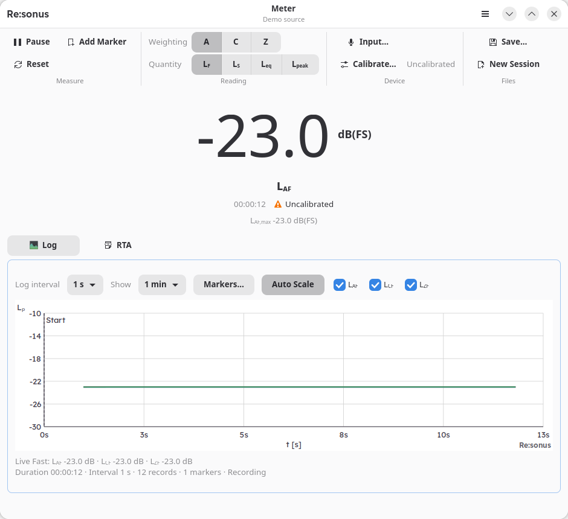

# Re:sonus Meter

Re:sonus Meter (formerly SPL Meter) is a native GNOME sound-level meter for
calibrated single-channel measurements. It computes A, C, and Z weightings with
Fast, Slow, Leq, and sample-peak detectors. It is part of the Re:sonus stack of
acoustic apps and shares their window layout and plot style (ADR 0017).



The layout: the header bar holds the brand, the app name with the input as
subtitle, and the main menu. The ribbon below groups the controls: Measure
(Pause, Reset, Add Marker), Reading (weighting and quantity), Device (input,
calibration and its status) and Files (Save, New Session). The Log and RTA
views are tabs below the reading; in narrow windows the tab switcher moves to
the bottom. Plots follow the light or dark system style.

The M4 app includes the main meter surface: choose A, C, or Z weighting and
Fast, Slow, Leq, or sample-peak readings. It also shows the Fast maximum and
clear uncalibrated and overload indicators. The Sound Device preferences page
always offers the deterministic demo source and, in standard builds, lists
available cpal input devices. Selecting a device, channel, and supported rate
opens it immediately; input errors and dropped samples are shown in the app.
The Log view below the meter plots the recorded Fast A/C/Z history with
toggleable traces and selectable 1 minute, 10 minute, 1 hour, or full-session
windows. Session markers (including automatic reset markers) are drawn as
labeled vertical lines. It also shows live Fast readings and recording status.
Its interval selector records an interval-change marker; **Add Marker** in the
ribbon (or <kbd>M</kbd>) closes the current segment and starts the next.
Click a marker line, or use **Markers…**, to change its label or add a note.
**Pause** in the ribbon (or <kbd>P</kbd>) interrupts the recording without
ending it: Fast and Slow stay live, Leq, peak and maximum hold, and no log
rows are written until **Resume**. Timestamps after a pause remain true
wall-clock times.
Both plots fit their level axis to the data and only move it when the data
nears an edge. Scroll over a plot (or use Up/Down when it has focus) to move
the axis and Ctrl+scroll (or +/−) to zoom; **Auto Scale** fits it again.
The **RTA** tab shows octave or one-third-octave band levels as bars, with a
Fast, Slow or Leq detector, A, C or Z display weighting and peak hold. It
analyses only while it is shown, so its Leq covers the time the tab was open
(and restarts on Reset). Bands, range and the tab's defaults are set on the
RTA preferences page. Saved measurements also hold the Z-weighted band Leq of
those bands per log interval and per segment (`rta_log.csv`,
`rta_segments.csv`), recorded for the whole session whether the tab is shown
or not; **Record band levels** in the RTA preferences turns this off. The
RTA tab shows the same log interval selector as the Log tab, since the band
levels are recorded at that interval.
The FFT and Waterfall tabs and distribution packages are implemented in
subsequent milestones.

Use **Save measurement** (or <kbd>Ctrl</kbd>+<kbd>S</kbd>) to choose the
destination folder, required measurement name, optional Markdown
description, the range to save (the whole recording or the part between two
markers, with a preview of its levels), and attachments such as photos or
datasheets, which are copied into the measurement folder. The app writes the canonical `<name>/` session bundle into that
folder and does not interrupt live measurement while saving. Existing
non-empty bundle directories are never overwritten.
After saving, a notification offers **Open Folder**. **New Session** in the
main menu (or <kbd>Ctrl</kbd>+<kbd>N</kbd>) discards the current measurement,
asking first if it has unsaved changes, and starts a fresh one.
Unsaved measurements are journaled to disk every minute by default (see
General preferences) and whenever a marker, pause or resume is added, so a
crash loses at most that interval of the log, never a marker. If the app or system stops unexpectedly, the next start
offers to recover the measurement: it reopens the same input and continues
paused, with a pause marker where the journal ends. If several runs were cut
short, one dialog lists them: recover one (the others are discarded) or
**Discard All**. Runs that recorded nothing are cleaned up silently. Closing
the window with unsaved changes asks whether to save first.

Use **Preferences** in the main menu (or <kbd>Ctrl</kbd>+<kbd>,</kbd>) to
select an input and apply a manual calibration offset. The Calibration page
also captures eight seconds of raw, unweighted audio from either the demo or a
live input. Enter the calibrator level and nominal frequency, press
**Capture**, review the detected tone and quality figures, then explicitly
press **Save** to apply its proposal. Capture never changes the reading on its
own. Saved measurement bundles identify an approved proposal as a calibrator
calibration.

The app reopens the input you used last. If it is unplugged, the app tries
the inputs used before it, then the demo source, and shows a notice. The
`--demo` option always starts with the demo source. Recent inputs are kept in
`settings.toml` next to the calibration history.

Calibrations are saved per input, meaning one device and channel. Switching
input loads that input's latest calibration; an input without one reads
uncalibrated dBFS. Reset keeps the calibration. Manual offset edits are saved
once they stop changing. The Calibration page lists every saved calibration
of the current input; **Restore** makes an older one active again. The history
is stored in `calibrations.toml` in the application's configuration folder
(`~/.config/cz.resonus.SplMeter/`, or the Flatpak equivalent; folders of the
former id `io.github.vyhyb.SPLMeter` are moved there once, ADR 0016). Changing
the system, driver or interface input gain invalidates a calibration.

Capture follows the selected PipeWire input, including the GNOME microphone
volume. The calibration result shows raw tone and sample-peak dBFS separately
from calibrated SPL, including the remaining peak headroom. A sample peak of
0 dBFS is the digital limit; a 0 dBFS-peak sine has an RMS level of
−3.01 dBFS.

## Development

Install Rust 1.88 or newer, GTK4 4.10 or newer, and libadwaita development
packages, then:

```sh
just check
just run-demo
```

Real capture is enabled by default through `spl-app`'s `cpal-backend` feature.
On Linux it requires the ALSA, PipeWire, PulseAudio, and Clang development
packages. A demo-only app can be built without it:

```sh
cargo check -p spl-app --no-default-features
```

See [CONTRIBUTING.md](CONTRIBUTING.md) for contributor requirements.

## License

AGPL-3.0-only (GNU Affero General Public License, version 3 only), as the
other Re:sonus apps. See [LICENSE](LICENSE) and ADR 0016. The bundled Lexend
fonts (`crates/spl-app/data/fonts/lexend/`) are under the SIL Open Font
License 1.1 (`OFL.txt` there).

Screenshots are made with `spl-app --demo --screenshot=FILE.png
[--screenshot-delay=SECONDS]`; for the dark style, set
`ADW_DEBUG_COLOR_SCHEME=prefer-dark`.
